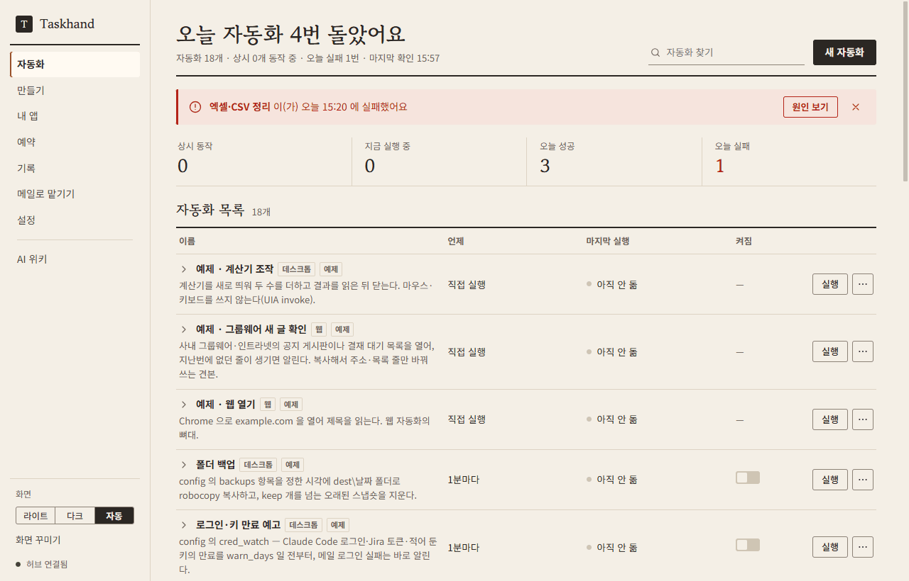
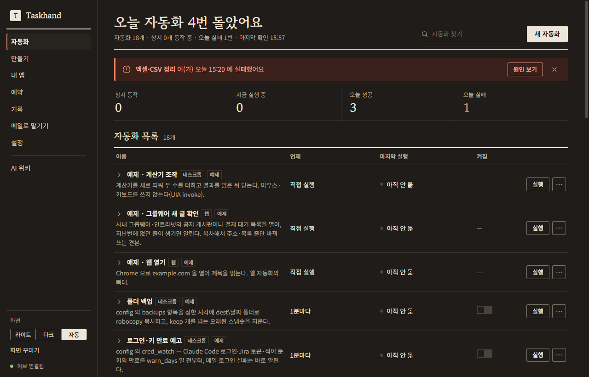
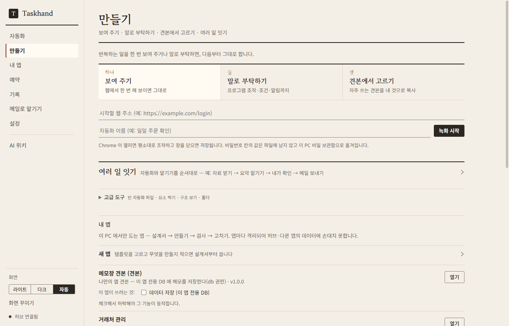
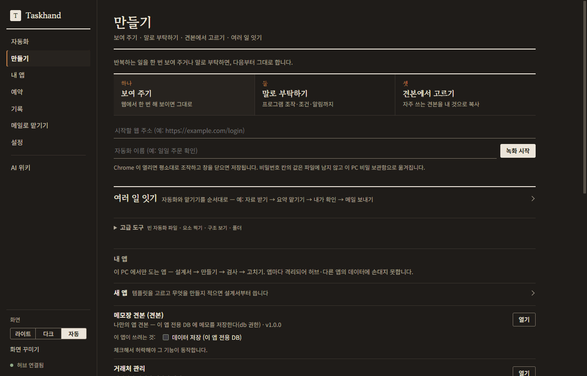
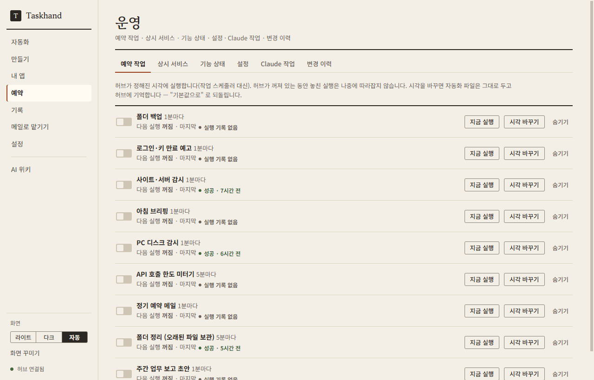
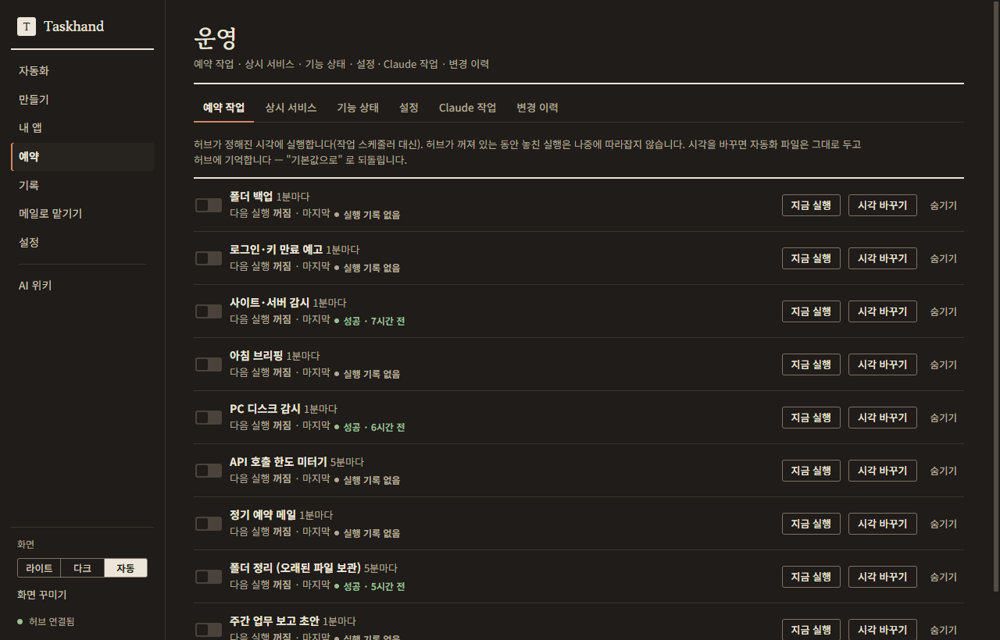
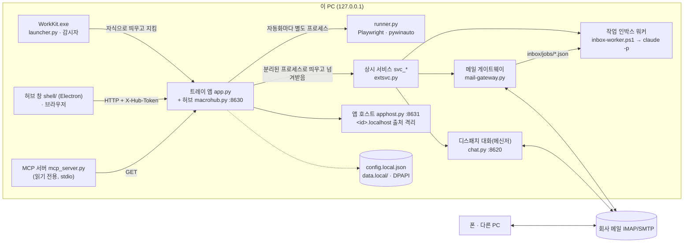

# Taskhand — 반복 업무를 맡기는 Windows 자동화

[](https://github.com/smh86278-stack/swbins-kit/actions/workflows/test.yml)


**회사 PC 한 대에서 반복 업무를 대신 돌려 주는, 설치형 개인 자동화 허브.** — [English summary](README.en.md)

## 무엇을 해 주나

- **정해진 일을 정해진 시각에** — 정기 메일 · 폴더 정리 · 백업 · 사이트/서버/디스크 감시 · 로그인·키 만료 예고 · 아침 브리핑.
  작업 스케줄러 없이 트레이에 상주하는 허브가 돌리고, 실패하면 메일·슬랙·Teams·웹훅으로 알린다.
- **화면 조작 자동화** — 웹(Playwright)·윈도우 프로그램(pywinauto)을 녹화하거나 파이썬으로 짜서 예약·창 뜸·프로세스 시작에 건다.
  비밀번호는 녹화 때 자동으로 비밀값으로 빼고, 실패하면 그 순간의 화면을 남긴다.
- **AI 와 같이 일하기** — 메일·메신저로 맡긴 일을 이 PC 의 Claude Code 가 처리하고 답하는 디스패치(기본 꺼짐),
  Claude Code · Codex · Gemini CLI · 로컬 Ollama 중에서 고르는 「말로 부탁하기」, 이 PC 에서만 도는 **나만의 앱**을 AI 와 함께 만들기.
- **어느 회사에서나** — 회사마다 다른 값은 `config.local.json` 한 파일에만. 관리자 권한·인터넷 없이 설치되는 단일 설치 파일.

## 화면



<details>
<summary>라이트 · 다크 · 만들기 · 운영 화면 더 보기</summary>

화면은 「종이 노트」 하나 — 라이트 · 다크 · 자동(Windows 설정 따라감) 중에서 고른다.

| | 라이트 | 다크 |
|---|---|---|
| 자동화 |  |  |
| 만들기 |  |  |
| 운영 |  |  |

</details>

화면 구성은 아래 [주요 기능](#주요-기능)과 [`docs/GUIDE.md`](docs/GUIDE.md) 참고.

## 설치 — 3단계

Windows 10/11 · Python 3.10 이상 · 관리자 권한 불필요.

1. **받기** — `git clone https://github.com/smh86278-stack/swbins-kit.git` (Python 은 설치할 때 "Add python.exe to PATH" 체크)
2. **처음 설정** — `python setup_gui.py` (창) 또는 `python setup.py` (명령 창). 회사 이름 · 메일 서버 · 계정을 넣으면
   비밀번호는 DPAPI 로 암호화돼 `config.local.json` 에 저장되고, 시험 메일을 한 통 보내 볼 수 있다.
3. **허브 시작** — `tools\macro-hub\setup.bat` (처음 한 번, `.venv` 에 패키지 설치) → `tools\macro-hub\start_app.bat`.
   트레이에 아이콘이 뜨고 <http://127.0.0.1:8630/> 이 열린다. 운영 화면 `/ops` 에서 기능을 켠다(처음엔 모두 꺼져 있다).

파이썬이 없는 PC 에 배포할 때는 내장 파이썬을 품은 단일 설치 파일을 만든다 — `installer\build_installer.py` →
`TaskhandSetup-<버전>.exe` (무인 설치 `/S`). 자세한 설치·업데이트·제거는 [`docs/GUIDE.md`](docs/GUIDE.md#설치--파일-하나-권장).

## 주요 기능

| 갈래 | 기능 | 구현 |
|---|---|---|
| 예약 작업 | 📮 정기 메일 · 🗂 폴더 정리 · 💾 백업 · ☀ 아침 브리핑 · 📝 주간 업무 보고 초안 | `macros/job_*.py` (9개) |
| 감시·알림 | 🌐 사이트·포트·인증서 · 💽 디스크 · 🔑 로그인·토큰 만료 예고 · ⏱ API 호출 한도 미터기 | `job_monitors` · `job_pc_watch` · `job_cred_watch` · `ratelimit.py` |
| 알림 출구 | 메일 · 슬랙 · Teams · 디스코드 · 구글 챗 · 일반 웹훅(HMAC 서명) — 같은 일은 60분에 한 번 | `kit.alert` · `alertmail.py` |
| 화면 자동화 | 웹·데스크톱 녹화 · 요소 찍기 · 트리거(시각·주기·창·프로세스) · 🧪 시험 실행 · 📸 실패 화면 · 📚 갤러리 | `macrohub.py` · `runner.py` · `winevents.py` |
| 일 순서 | 만들기 → 「여러 일 잇기」. 자동화·맡기기 단계를 순서대로 이어 돌리기(앞 단계 결과 → AI → 다음 단계) · 확인 모드(단계마다 · AI 답만 · 자동) · 조건(앞 결과에 말이 있으면·없으면·AI 판단) · 📮 메일로 부르기(`#c 일 순서 <이름>`, 확인도 답장으로) · 나만의 도우미(역할을 저장해 맡기기 단계에서 고르기) | `runner.py` (`run_chain`) · `macrohub.py` |
| 상시 서비스 | 외부 프로그램(게이트웨이·워커·대화 앱)을 허브와 분리된 프로세스로 띄우고 죽으면 다시 살림 | `extsvc.py` · `macros/svc_*.py` (5개) |
| AI 연동 | 🧠 AI 고르기(Claude Code · Codex · Gemini CLI · Ollama) · 🔌 읽기 전용 MCP 서버 | `aicli.py` · `ollama_agent.py` · `mcp_server.py` |
| 나만의 앱 | 템플릿 6종 → AI 설계서 → 생성 → 실제 브라우저 자동 검사 → 버전 관리 → zip/HTML 한 장/exe 내보내기 | `apphost.py` · `appcheck.py` · `apphistory.py` · `apppack.py` |
| 디스패치 (기본 꺼짐) | 메일·메신저로 맡긴 일을 Claude Code 가 처리하고 회신 · 권한 묻기 · Jira 새 이슈 감시 | `mail-gateway.py` · `inbox-worker.ps1` · `tools/dispatch-chat/` |
| 운영 | 켜기/끄기 · 예약 시각 변경 · 기능 상태 · 📜 변경 이력(누가·어디서·언제) | `ops.py` · `web/ops.html` |
| 배포 | 단일 설치 파일(내장 파이썬) · PC 이전 묶음(암호 걸린 7z) | `installer/` · `tools/pc-migrate/` |

기능별 설정과 켜는 순서는 [`docs/GUIDE.md`](docs/GUIDE.md), 자동화 작성법은 [`tools/macro-hub/AUTHORING.md`](tools/macro-hub/AUTHORING.md),
앱 작성법은 [`tools/macro-hub/APP_AUTHORING.md`](tools/macro-hub/APP_AUTHORING.md).

## 구조



- **허브**(`macrohub.py`)는 표준 라이브러리 `ThreadingHTTPServer` 하나로 화면·API·SSE 실시간 로그를 내주고, 트리거·상시 서비스 감독 스레드를 돌린다.
- 자동화 한 개는 항상 **별도 프로세스**(`runner.py`)에서 돈다 — 허브가 자동화 오류·무한 루프에 같이 죽지 않고, 중지는 프로세스 트리째.
- 폰↔PC 직접 연결 대신 **회사 메일을 통로로** 쓴다 — 사내 방화벽·망분리에서도 동작하고 자료가 회사 메일 밖으로 나가지 않는다.

구성 요소·데이터 흐름·설계 결정은 [`docs/ARCHITECTURE.md`](docs/ARCHITECTURE.md).

## 보안 설계

프로그램을 띄우고 코드를 실행하는 도구라서, 기본값을 닫힌 쪽에 두었다. 아래는 모두 코드에 있는 장치다.

| 위협 | 막는 방법 | 코드 |
|---|---|---|
| 같은 망에서 허브 원격 조작 | 허브·앱 호스트·대화 앱·AI 위키 모두 `127.0.0.1` 에만 바인딩 | `macrohub.start_services` · `apphost.make_server` · `chat.py` · `agent.py serve` |
| 다른 웹 페이지의 요청 위조(CSRF) | 쓰기 요청은 허브가 시작할 때마다 새로 만드는 토큰(`X-Hub-Token`)이 있어야 함 — 화면 HTML 에만 심고 파일로 남기지 않음. `Origin` 검사 | `macrohub.Handler.do_POST` |
| DNS 리바인딩 | `Host` 머리글이 `127.0.0.1:<포트>`·`localhost:<포트>` 가 아니면 403 | `Handler._host_ok` |
| 클릭재킹 | `X-Frame-Options: DENY` · CSP `frame-ancestors 'none'` · `nosniff` | `Handler._send` |
| AI 가 만든 앱이 허브·다른 앱·바깥을 건드림 | 앱마다 다른 출처 `http://<id>.localhost:8631/` · Host 검사 · API 는 `X-App` 머리글 + 같은 Origin · CSP `connect-src 'self'` · 권한(db·files·ai·run·notify)은 사람이 허락한 것만 · 시간당 상한 | `apphost.py` |
| 비밀번호·토큰 평문 저장 | Windows DPAPI 로 암호화(`password_enc`·`token_enc`·`dpapi:` 비밀값) — 이 PC·이 사용자만 풀 수 있음. 녹화 스크립트의 비밀번호 칸은 비밀값으로 자동 치환, 로그에선 가림 | `kit.protect` · `hubutil` · `macrohub.secretize_recording` |
| 메일 한 통으로 명령 실행 | 디스패치는 기본 꺼짐 · 허용 발신자 목록(비면 전부 무시) · 회사 밖 주소는 암호 단어(`compare_digest`, 기한) · 작업 폴더 한정 · 읽기 지시는 읽기 도구만 | `mail-gateway.py` · `chat_runner.py` |
| 허용 명령 우회(`git log --output=…` 등) · 위험한 브라우저 동작 | Claude Code `PreToolUse` 훅 — 명령 잇기·git 쓰기 옵션 차단(fail-closed), 브라우저는 허용 목록 밖이면 사람 확인 | `tools/dispatch-chat/bash-guard.js` · `browser-guard.js` |
| AI 도구에 넘치는 권한 | MCP 서버는 GET 만, 비밀값·메일 본문을 내주지 않음 · Codex 는 작업 폴더 샌드박스 · Ollama 결과는 내 자동화 폴더에만 씀 | `mcp_server.py` · `aicli.py` · `ollama_agent.py` |
| 누가 무엇을 바꿨는지 모름 | 켜기/끄기·시각 변경·설정 변경(키 이름만, 값 없음)을 사용자·출처·시각과 함께 기록 | `kit.audit` → `data.local/audit.jsonl` |

설정·기록(`config.local.json` · `*.local.json` · `data.local/` · `inbox/`)은 `.gitignore` 로 저장소에 들어가지 않는다.
자동화와 앱은 결국 이 PC 에서 도는 코드다 — 남이 준 것은 열어 보고 돌린다.

## 시험 실행

```
python -X utf8 -m unittest discover -s tests                 단위·통합 시험 (네트워크·실제 메일 없음, 허브를 띄우지 않음)
powershell -ExecutionPolicy Bypass -File tests\verify.ps1    커밋 전 — 저장소의 모든 .py py_compile + 위 시험
```

- 30개 파일, 565개 시험(2026-10 기준, 이 PC 의 Windows·Python 3.10 에서 8개는 환경 조건으로 건너뜀).
  메일은 가짜 IMAP/SMTP, Claude CLI 는 가짜 실행 파일로 대신한다.
- 실제 브라우저(Playwright)가 필요한 시험은 `KIT_BROWSER_TESTS=0` 으로 건너뛴다 — CI 는 이렇게 돈다.
- CI: GitHub Actions `windows-latest` 에서 push·PR 마다 `tests\verify.ps1` ([`.github/workflows/test.yml`](.github/workflows/test.yml)).

## 저장소 지도

```
setup.py · setup_gui.py          처음 설정 (명령 창 · 창)
config.example.json              설정 견본 — 갈래마다 "_설명"
mail-gateway.py · inbox-worker.ps1 · jira-watch.py    디스패치 (기본 꺼짐)
tools/macro-hub/                 자동화 허브 — 트레이 앱 · 웹 화면 · 러너 · 앱 호스트 · 예약 작업 (README.md)
tools/dispatch-chat/             디스패치 대화(메신저) 앱 · Claude Code 훅
tools/ai-share-agent/            주간 업무 보고 초안 · AI 공유 위키
tools/pc-migrate/                PC 이전 묶음
dispatch-page/                   폰에서 지시 보내는 정적 페이지
installer/                       단일 설치 파일 빌드
docs/                            GUIDE.md(사용 안내) · ARCHITECTURE.md(설계) · index.html(코드에서 만드는 도움말)
tests/                           unittest · verify.ps1
```

## 라이선스

저장소 전체 라이선스: MIT — [LICENSE](LICENSE).
동봉한 서드파티 라이브러리는 각자의 라이선스를 따른다 — Preact·htm·Chart.js·Phaser·sql.js
([`tools/macro-hub/apps-lib/`](tools/macro-hub/apps-lib/) 의 `LICENSE-*.txt`), 기본 펫 그림은
[`tools/macro-hub/web/skins/plush/LICENSE.txt`](tools/macro-hub/web/skins/plush/LICENSE.txt).
