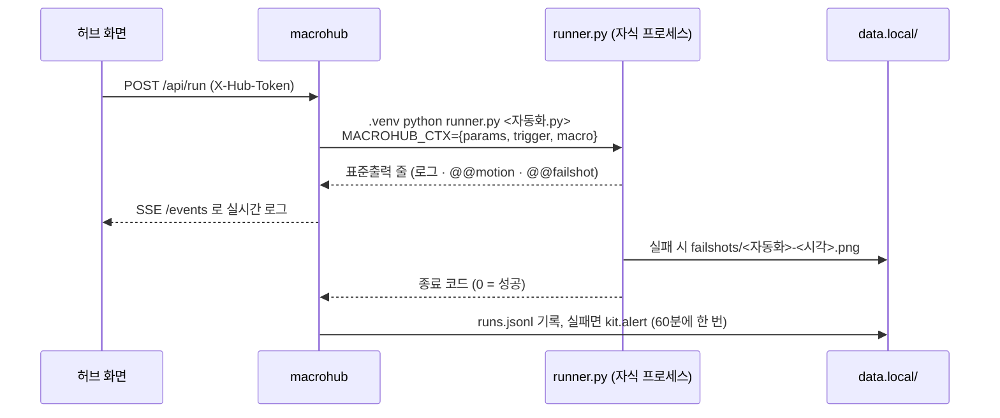
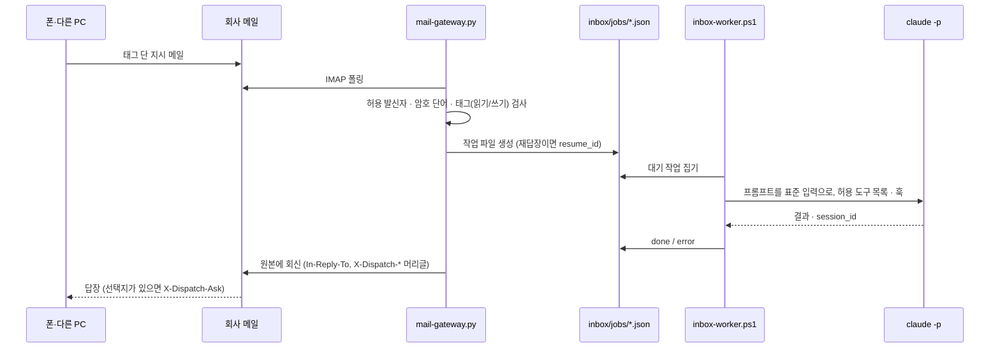

# 아키텍처

업무 자동화 키트의 구성 요소, 데이터 흐름, 설계 결정(왜 그렇게 했나), 확장 지점을 실제 코드 기준으로 정리한다.
사용법은 [`GUIDE.md`](GUIDE.md), 첫 소개는 [`../README.md`](../README.md).

## 1. 한눈에

- **대상**: 회사 PC 한 대(Windows 10/11), 사용자 한 명. 서버·클라우드 없이 그 PC 안에서 끝난다.
- **언어·의존성**: 핵심(허브·러너·키트 공통·게이트웨이·앱 호스트·MCP 서버)은 **파이썬 표준 라이브러리만** 쓴다.
  화면 조작 자동화만 Playwright·pywinauto, 트레이만 pystray·Pillow 를 `.venv` 에 둔다. 창은 Electron(`shell/`, `pet/`).
- **규모**: 추적 중인 파이썬 90개 파일·약 3.1만 줄, 시험 30개 파일·565개.

```
WorkKit.exe (launcher.py) ─감시─▶ app.py --child (트레이 + macrohub 허브 :8630)
                                     ├─ trigger_loop   창 이벤트 · 프로세스 · 시각 예약
                                     ├─ service_loop   상시 자동화 살려 두기
                                     ├─ runner.py ×N   자동화 1개 = 프로세스 1개
                                     ├─ extsvc         svc_* 외부 프로그램(분리된 프로세스)
                                     └─ apphost :8631  나만의 앱 (<id>.localhost 출처)
mail-gateway.py ⇄ 회사 메일 ⇄ 폰·다른 PC          inbox/jobs ─▶ inbox-worker.ps1 ─▶ claude -p
dispatch-chat/chat.py :8620  메일을 메신저처럼      mcp_server.py (stdio, 허브 GET 만)
```

## 2. 구성 요소

| 구성 요소 | 파일 | 역할 |
|---|---|---|
| 입구·감시자 | `tools/macro-hub/launcher.py` → `WorkKit.exe` | 트레이 앱을 자식으로 띄우고 지킨다. 종료 코드 0 = 끝, 3 = 바로 재시작, 그 외 = 다시 띄움(5분에 5번 죽으면 멈추고 알림). 뮤텍스로 하나만 |
| 트레이 앱 | `app.py` | 허브를 같은 프로세스에서 돌리고 트레이 메뉴·알림 풍선·로그온 자동 시작(HKCU Run)·실패 알림 메일 |
| 허브 | `macrohub.py` | `ThreadingHTTPServer` 하나로 화면(HTML)·JSON API·SSE(`/events`) 실시간 로그. 자동화 발견(`discover`)·실행·트리거·상시 감독·녹화·갤러리·묶음 |
| 러너 | `runner.py` | 자동화 1개를 `.venv` 파이썬 별도 프로세스로 실행. `ctx`(브라우저·창·비밀값·로그·알림) 제공, 시험 모드(`dry_run`), 실패 화면 캡처, 묶음(`kind: chain`) 실행 |
| 창 이벤트 | `winevents.py` | `SetWinEventHook` 으로 창 생성·제목 변화를 받아 `window` 트리거를 폴링 없이 깨운다 |
| 외부 서비스 | `extsvc.py` · `macros/svc_*.py` | 게이트웨이·워커·대화 앱·Jira 감시·AI 위키를 허브와 **분리된 프로세스**로 띄우고 `META["owns"]` 로 찾아 넘겨받는다 |
| 기능(예약 작업) | `macros/job_*.py` | 정기 메일·폴더 정리·감시·백업·만료 예고·브리핑 등. 결과는 `kit.write_status` → 운영 화면 |
| 키트 공통 | `kit.py` | 설정(`config.local.json`)·메일(IMAP/SMTP)·DPAPI·알림 출구·예약 판정·상태 파일·변경 이력. **함수 이름·인자를 바꾸지 않는 공개 계약** |
| 운영 화면 | `ops.py` · `web/ops.html` | 예약 작업·상시 서비스·기능 상태·설정 준비 여부·에이전트 보드·변경 이력 |
| AI 고르기 | `aicli.py` · `ollama_agent.py` | Claude Code · Codex · Gemini CLI · Ollama 명령줄 조립. Ollama 는 스스로 파일을 못 다뤄 `ollama_agent` 가 손발 |
| 앱 호스트 | `apphost.py` | 나만의 앱을 앱마다 다른 출처에서 서비스, 권한별 API(db·files·ai·run·notify) |
| 앱 도구 | `appcheck.py` · `apphistory.py` · `apppack.py` | 실제 브라우저 검사 · 버전(스냅숏·되돌리기) · zip/HTML 한 장/exe 내보내기·가져오기 |
| MCP 서버 | `mcp_server.py` | stdio JSON-RPC, 허브 GET API 와 기록 파일만 읽는다 |
| 디스패치 | `mail-gateway.py` · `inbox-worker.ps1` · `jira-watch.py` | 메일 지시 → 작업 큐 → Claude Code 실행 → 회신 (기본 꺼짐) |
| 대화 앱 | `tools/dispatch-chat/` | 메일함을 대화방처럼 보여 주는 화면(:8620), 선택적 직접 실행(`chat_runner.py`), Claude Code 훅(`bash-guard.js`·`browser-guard.js`) |
| 설치 | `installer/` · `setup.py` · `setup_gui.py` · `uninstall.py` | 내장 파이썬 단일 설치 파일, 처음 설정 |

## 3. 데이터 흐름

### 3.1 자동화 한 번 실행



- 트리거는 `trigger_loop` 한 스레드가 맡는다 — 창 이벤트는 큐로 즉시, 프로세스·시각 예약은 0.5초마다.
  시각 예약은 "지난 확인 ~ 지금" 구간에 그 시각이 있었는지로 판정하고, 처음엔 오늘 0시부터 봐서 허브가 꺼져 있던 동안 놓친 **오늘** 예약만 한 번 따라잡는다.
- 같은 자동화가 실행 중이면 새로 켜지 않고, `cooldown` 안의 재발동은 무시한다.
- 화면에서 바꾼 예약 시각·입력값은 `state.local.json` 에 들어가고, 자동화 파일의 `META` 는 기본값으로 남는다.

### 3.2 상시 서비스

`service_loop` 가 3초마다 켜 둔 `service: True` 자동화를 확인하고, 죽어 있으면 다시 띄운다(바로 죽기를 반복하면 3→6→…→60초).
`svc_*` 는 `extsvc.supervise` 로 진짜 프로그램을 **중간 프로세스를 거쳐 부모 관계를 끊고** 띄운다.
허브가 재시작돼도 프로그램은 계속 돌고, 새 허브가 `owns`(프로세스 이름 + 커맨드라인 문자열)로 찾아 이어서 지켜본다.
도구는 `state.json`(살아 있음)·`paused.flag`·`notify.jsonl`(알림 큐) 파일 규약으로 허브와 대화한다.

### 3.3 디스패치 — 메일로 일 맡기기 (기본 꺼짐)



- 허용 목록 밖 도구에서 막히면 회신에 "허용하고 이어서 하기" 질문을 붙이고, 허락하면 **그 권한만** 더해 같은 세션을 이어 간다.
- 대화 앱(`chat.py`)은 같은 메일함을 IMAP 으로 읽어 대화 번호별 말풍선으로 묶는다 — PC 끼리 직접 연결이 필요 없다.
- 허브의 「말로 부탁하기」(`ask_chat`)는 같은 PC 의 대화 앱 화면에서 그때그때 토큰을 읽어 `/api/send` 로 보낸다(대화 앱 계정이 키트 계정과 다르면 보내지 않음).

### 3.4 나만의 앱

```
🛠 만들기 → 템플릿(app-templates/*) 복사 → AI 설계서 → 확인 → AI 가 코드 작성(apphistory 가 전·후 스냅숏)
        → appcheck: 임시 서버(port 0)·임시 데이터·가짜 AI/실행/알림 훅으로 실제 브라우저 검사
          (콘솔 오류 · 잡히지 않은 예외 · CSP 위반 · tests/smoke.json 시나리오 · 스크린샷)
        → 실패하면 고치기 반복 → http://<id>.localhost:8631/ 에서 사용 → apppack 으로 내보내기
```

앱의 데이터는 앱 폴더가 아니라 `data.local/apps/<id>/` 에 둔다 — 키트 업데이트로 견본 폴더가 덮여도 사용자의 데이터는 남는다.

## 4. 설계 결정

| 결정 | 이유 | 대가 |
|---|---|---|
| **작업 스케줄러 대신 트레이 상주 허브** | 예약·상시 감시·실패 알림·실행 기록·화면을 한곳에서 다루고, 관리자 권한 없이 설치·제거가 깔끔하다 | 허브가 떠 있어야 돈다 → 감시자(`launcher.py`)와 로그온 자동 시작, 놓친 오늘 예약 따라잡기로 보완 |
| **자동화 1개 = 프로세스 1개** | 임의의 사용자 코드가 허브를 죽이거나 막지 못한다. 시간 초과·중지 시 프로세스 트리째 정리 | 실행마다 파이썬 기동 비용(수백 ms) — 사람 업무 주기에선 무시할 수준 |
| **외부 서비스는 분리된 프로세스 + 넘겨받기** | 허브를 고쳐 재시작해도 진행 중인 Claude 작업·서버가 끊기지 않는다 | 프로세스를 이름·커맨드라인으로 식별해야 해서 `--kit-service` 같은 표식 인자를 붙인다 |
| **표준 라이브러리 우선** | 사내 PC 는 pip 가 막힌 곳이 많다. 내장 파이썬 설치 파일 하나로 끝나고, 대화 앱은 PyInstaller exe 한 파일이 된다 | HTTP 서버·JSON-RPC·MIME 처리를 직접 짠다 — 시험으로 메운다 |
| **회사 메일을 폰↔PC 통로로** | 사내 방화벽·망분리에서 직접 연결은 막혀 있어도 메일은 닿는다. 자료가 회사 메일 밖으로 나가지 않는다 | 지연(폴링 주기)과 발신자 위조 위험 → 허용 목록·암호 단어·기본 꺼짐 |
| **설정은 `config.local.json` 한 파일, 읽기는 `kit.py` 로만** | 어느 회사에서나 쓰는 범용 키트 — 회사 값을 코드에 박지 않는다. 견본·설명은 `config.example.json`, 시험이 문서와의 어긋남을 잡는다 | 갈래가 늘수록 견본 파일이 길어진다 |
| **실행 토큰은 시작할 때마다 새로, 화면에만** | 같은 PC 의 다른 웹 페이지가 `127.0.0.1` 로 보내는 요청(CSRF)을 막는다. 파일에 남기지 않아 다른 프로그램이 훔쳐 갈 곳이 없다 | MCP 서버 같은 외부 도구는 쓰기를 못 한다 — 의도한 제약 |
| **앱마다 `<id>.localhost` 출처** | 브라우저의 동일 출처 정책을 그대로 격리 장치로 쓴다 — 앱 스크립트가 허브 토큰·다른 앱 데이터에 닿지 못한다. 별도 샌드박스 런타임이 필요 없다 | `*.localhost` 해석에 기대므로 Host 머리글 검사를 함께 둔다 |
| **비밀값은 DPAPI** | OS 가 사용자 로그인에 묶어 관리하는 키라 키 파일을 따로 지킬 필요가 없다 | 다른 PC·다른 사용자에서 안 풀린다 → PC 이전 시 다시 입력(설계상 의도) |
| **Claude Code 는 CLI 로그인으로 호출(`claude -p`)** | API 키 과금·키 보관 없이 사용자의 구독을 쓴다. 권한은 허용 도구 목록과 `PreToolUse` 훅으로 좁힌다 | CLI 출력 형식·옵션 변화에 따라가야 한다 → 가짜 CLI 로 시험 |
| **위험한 동작은 기본 꺼짐** | 디스패치·Jira 감시·AI 시험 실행 등 PC 밖 입력으로 코드가 도는 길은 사용자가 명시적으로 켜야만 동작한다 | 처음 쓰는 사람에게 설정 단계가 하나 더 있다 |

## 5. 보안 경계

- **네트워크**: 모든 HTTP 서버가 `127.0.0.1` 바인딩. 허브는 `Host` 가 `127.0.0.1:<포트>`/`localhost:<포트>` 일 때만 응답(DNS 리바인딩).
- **요청 위조**: 허브 POST 와 부작용 있는 GET 은 `X-Hub-Token` 필수, `Origin` 이 있으면 Host 와 같아야 한다. 앱 API 는 POST + `X-App` 머리글 + 같은 Origin.
- **화면**: `X-Frame-Options: DENY`, CSP `frame-ancestors 'none'`, `nosniff`. 받은 HTML 을 보여 줄 땐 CSP `sandbox`. 앱은 `connect-src 'self'` 로 바깥 전송 차단.
- **비밀값**: DPAPI(`kit.protect`/`hubutil.seal`). 평문으로 넣은 `secrets.local.json` 은 허브 시작 시 그 자리에서 암호화. 녹화의 비밀번호 칸은 `secret('…')` 로 치환, 로그에선 가림.
- **AI 실행**: 읽기 지시는 읽기 도구만. Bash 가 일부만 허용된 작업엔 `bash-guard.js`(명령 잇기·git 쓰기 옵션 차단, 오류 시 막음). 브라우저 도구는 `browser-guard.js` 허용 목록 밖이면 사람 확인. Jira 이슈 본문 같은 남의 글은 "자료로만 읽으라"고 감싸고 바깥 전송 명령을 막는다.
- **감사**: `kit.audit` 이 켜기/끄기·시각·설정 변경(키 이름만)을 `data.local/audit.jsonl` 에 남긴다.

## 6. 확장 지점

| 넣고 싶은 것 | 방법 |
|---|---|
| 새 기능(예약 작업) | `tools/macro-hub/macros/job_<이름>.py` 에 `META`(이름·트리거) + `run(ctx)`, 결과는 `kit.write_status(기능, items)`. 운영 화면 목록은 `ops.FEATURES`. 설정 갈래는 `config.example.json` 에 견본·`_설명`, `docs/build_docs.py` 의 `SECTIONS` 에 등록(시험이 빠뜨림을 잡는다) |
| 새 상시 서비스 | `macros/svc_<이름>.py` 에서 `extsvc.supervise(ctx, cmd=…, owns=META["owns"])` |
| 사용자 자동화 | `macros.local/<이름>.py` — `META` + `run(ctx)` 또는 녹화 스크립트. 작성법 `tools/macro-hub/AUTHORING.md`, 시험 `runner.py --test` |
| 자동화 갤러리 견본 | `tools/macro-hub/gallery/<이름>.py` 하나 (META 의 `secrets`·`hint` 가 카드에 보인다) |
| 앱 템플릿 | `tools/macro-hub/app-templates/<이름>/template.json` + 앱 파일. 작성법 `APP_AUTHORING.md` |
| 앱 권한 | `apphost.PERMS`·`LIMITS` 와 허브가 연결하는 `apphost.HOOKS` |
| 알림 채널 | `kit.channel_payload(kind, …)` 에 형식 추가, `setup.py --webhook` 안내 |
| AI 엔진 | `aicli.py` 의 엔진별 명령 조립(`text`·`agent_cmd`) |
| 자동화 공통 도구 | `runner.py` 의 `ctx` 메서드(도움말 `docs/index.html` 이 코드에서 자동으로 뽑는다) |

## 7. 시험 전략

- **표준 라이브러리 `unittest`**, 허브를 띄우지 않고 메일을 보내지 않는다. 메일은 가짜 IMAP/SMTP 객체, Claude CLI 는 가짜 실행 파일,
  메일 경로는 `send=`·`ready=` 인자나 `mock.patch` 로 막는다.
- HTTP 경계(토큰·Host·Origin·CSP·앱 출처 격리)는 `port=0` 으로 실제 서버를 띄워 요청으로 확인한다(`test_security_hub.py`·`test_apphost.py`).
- Claude Code 훅은 Node 로 실제 실행해 우회 시도 문자열을 넣어 본다(`test_bash_guard.py`·`test_browser_guard.py`).
- 문서 동기화: `docs/index.html` 이 코드에서 다시 만든 것과 같은지, 공개 문서에 견본이 아닌 메일 주소가 없는지(`test_docs.py`).
- `tests/verify.ps1` 이 모든 `.py` py_compile + 시험을 돌린다. CI(GitHub Actions `windows-latest`)도 같은 스크립트를 쓰고,
  실제 브라우저가 필요한 시험만 `KIT_BROWSER_TESTS=0` 으로 건너뛴다.
